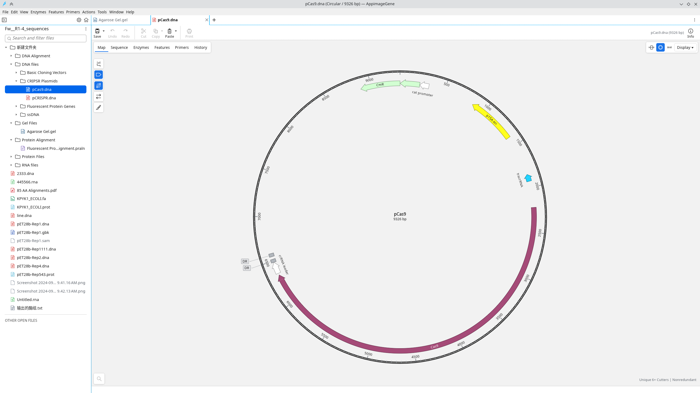
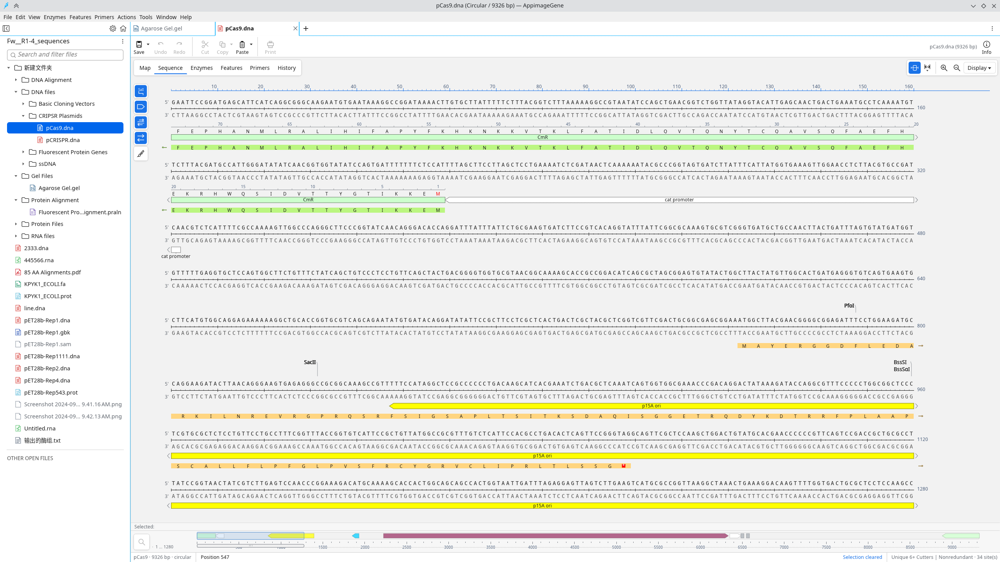

# AppimageGene

AppimageGene（AG）是一款使用 Rust 开发的 DNA、RNA 和蛋白质序列查看、编辑与克隆模拟桌面应用，提供 English / 简体中文界面。

## 界面预览





截图由项目维护者提供；截图中的文档不作为模板或序列文件随源码分发。

## 功能

- 环状／线性图谱、序列、特征、酶和引物视图。
- 序列与注释编辑、撤销／重做、原生文件保存与分子历史显示。
- 限制酶位点搜索、酶集合、引物搜索与设计。
- 多种分子克隆工作流；不同方法的支持程度有差异，不保证与其他软件完全等价。
- 凝胶泳道编辑、分子标记、酶切片段选择与黏性末端高亮。
- 内嵌 ViennaRNA 的 RNA 折叠与布局。
- 可编辑 TXT、只读 PDF，以及原生比对结果显示。

**限制：**凝胶迁移仍为近似模拟；原生比对结果目前只读；部分菜单明确禁用。中文适配仍可能在复杂诊断或外部工具消息中保留英文。请保留重要序列的备份，并核验计算结果。

AppimageGene 是独立项目，不隶属于 SnapGene 或其权利人，也不要求安装 SnapGene 才能启动。可选的本地商业载体模板不随项目分发。

## 从源码构建

需要 Rust **1.95 或更新版本**，以及 C 编译器（用于内嵌 ViennaRNA）。

```bash
cargo build --locked --release -p hx-app
cargo run --locked --release -p hx-app -- /path/to/sequence.dna
cargo test --locked --workspace
```

Linux 使用系统提供的 X11/Wayland、OpenGL 和字体；Debian/Ubuntu 通常需要 `build-essential pkg-config libx11-dev libxi-dev libxrandr-dev libxcursor-dev libxinerama-dev libgl1-mesa-dev libwayland-dev libxkbcommon-dev`。中文显示建议安装 Noto Sans CJK。

### Windows x64

在 Visual Studio C++ Build Tools（含 Windows SDK）环境中：

```powershell
cargo build --locked --release -p hx-app --target x86_64-pc-windows-msvc
python scripts/package-windows.py --target x86_64-pc-windows-msvc
```

Linux + MinGW 交叉构建：安装匹配的 Rust `x86_64-pc-windows-gnu` 标准库后，运行 `bash scripts/build-windows.sh`。

已验证 GNU x64 交叉编译及隔离 Wine 启动；MSVC 和真实 Windows 桌面功能仍需实机验证。程序使用原生 Windows 文件对话框和资源管理器。便携包解压后运行 `appimagegene.exe`；未配置代码签名，可能出现未知发布者提示。

### PDF 预览

预览使用 Poppler 的 `pdfinfo` 和 `pdftoppm`。Linux 可安装 `poppler-utils`；Windows 可将可信 Poppler 分发包（包含配套 DLL）放在程序旁的 `poppler/bin/` 或 `poppler/Library/bin/`，也可放入 PATH。项目不自动下载或随源码分发 Poppler。缺少工具时可以用系统默认 PDF 阅读器打开；PDF 始终只读。

## 语言与配置

通过 **Edit → Preferences… → General → Language / 语言** 切换语言。

- Linux：`$XDG_CONFIG_HOME/appimagegene`，默认 `~/.config/appimagegene`。
- Windows：`%APPDATA%\appimagegene`，回退至 `%LOCALAPPDATA%`。

配置保存语言、文件夹和已保存文件的工作区；退出前仍需保存未保存的文档修改。

## 开发工具

- `scripts/audit-localization.py --check`：检查直接 UI 文字遗漏。
- `scripts/build-windows.sh`、`scripts/package-windows.py`：构建和打包。
- `scripts/windows-smoke.ps1`：独立配置下的 Windows 手动检查。
- `scripts/install-appimagegene-desktop.sh`：Linux 用户桌面集成。

公开源码不包含研究目录、开发截图、商业模板和编译产物。核心回归使用源码内合成数据；需要本地软件安装／样例的可选测试可能跳过，跳过不表示兼容性验证通过。

## 组件与第三方许可

工作区包括 `hx-app`、`hx-cli`、`hx-core`、`hx-formats`、`hx-enzymes`、`hx-algo`、`hx-render`、`hx-vienna`。`hx-*` 是内部 crate 名称。

项目自有 Rust 代码声明 MIT；第三方组件保留各自许可证。ViennaRNA 归其作者及维也纳大学理论化学研究所所有，许可见 `vendor/viennarna/COPYING` 和 `AUTHORS`，其中包含再分发限制，不能将其视为 MIT。酶／标记数据与图标的来源和再分发权限应由维护者确认；本 README 不授予第三方权利。
